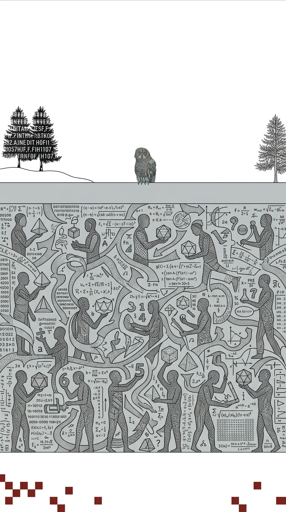

  🌐 <strong>Язык:</strong> Русский &bull; <a href="./">«Интерфейс наблюдателя»</a> &bull; <a href="synesthesia.html">«Комбинаторная синестезия»</a>
  <a href="../gray-wall.html" class="lang-btn">🇬🇧 Read in English (EN)</a>

# Серая стена сингулярности: Интеллигибельная сингулярность и уязвимый мир

**Автор:** Игорь Жук ([igor.m.zhuk@gmail.com](mailto:igor.m.zhuk@gmail.com))  
*Исследовательский проект Distinction Observable Theory (DOT / ТНР)*  
*Архив проекта:* [github.com/Nondual-Observer/DOTheory](https://github.com/Nondual-Observer/DOTheory/blob/main/ru/README_RU.md)

> **Epistemic status:** _Exploratory / Scenario Modeling. Вероятность того, что траектория AGI пойдет по пути Интеллигибельной теории (компактной и понятной человеку), а не навсегда останется непроницаемым чёрным ящиком, оцениваю как умеренную (~15–25%), но считаю её критически недоисследованной. Фокус статьи — мысленный эксперимент с одним жестко заданным граничным условием._

---

О технологической сингулярности обычно говорят как о моменте, после которого человеческое понимание не успевает за машинным интеллектом. Искусственный интеллект будет открывать новые законы, создавать технологии и совершенствовать собственные модели с такой скоростью, что человеку останется пользоваться результатами его работы.

Уже сегодня большинство окружающих нас устройств выглядят почти магическими для тех, кто не знаком с их устройством. Но внутри этой «магии» — вполне понятные людям принципы, исследования, расчёты и инженерные решения. При этом никто из людей не держит в голове целиком все знания. Они существуют как общее достояние множества ученых и специалистов, которое передаётся, проверяется и развивается. Наука уже до эры AGI является коллективным способом понимания мира.

**А что, если и главный результат AGI так же войдёт в этот общий запас знаний?**

Представьте, что искусственный интеллект откроет достаточно понятную человеку, но при этом глубокую математическую теорию. Такую, что ранее раздельные области математики станут видны как части одной структуры. При этом подготовленные специалисты смогут освоить её принципы и вполне применять их самостоятельно. А если новая теория одновременно даст существенный выигрыш в уже известных вычислениях, изменится прежде всего распределение влияния между людьми в обществе.

Это единственно заданное условие статьи.

Назовем этот сценарий **Постижимой (Интеллигибельной) сингулярностью** (*Intelligible Singularity*) — в противоположность привычной «сингулярности черного ящика». Её суть в том, что фундаментальное знание, созданное AGI, возвращается человеку в компактном, ясном и пригодном для самостоятельного развития виде.

---

### Серый шар: знание всегда приходит вместе с последствиями

В 2019 году философ Ник Бостром предложил [гипотезу «уязвимого мира»](https://onlinelibrary.wiley.com/doi/full/10.1111/1758-5899.12718). В его мысленном эксперименте человечество извлекает открытия из огромной урны. Белые шары приносят преимущественно пользу, серые обладают смешанными последствиями, чёрный шар при привычном устройстве общества делает цивилизационную катастрофу чрезвычайно вероятной. Бостром замечает, что технологии из урны могут быть связаны: одно открытие приближает целую группу других.

История науки дала нам немало серых шаров, особенно среди самых мощных технологий. Довольно яркий пример – ядерная физика. Она открыла как путь к атомному оружию (поставив мир перед угрозой самоуничтожения при этом), так и дала атомную энергетику, лучевую терапию, медицинскую диагностику и множество исследовательских методов. За пределами научной лаборатории судьба технологии определялась в большей степени политическими решениями отдельных людей и устройством цивилизации в целом.

В рамках заданного ранее условия меня интересует следующее возможное научное открытие: глубокое математическое знание, которое увеличивает скорость и снижает стоимость самого получения новых результатов. Последствия такого знания могут проявиться сразу во многих отраслях в относительно короткие сроки.

---

### Как новые идеи меняли возможности науки

В середине XIX века Джеймс Клерк Максвелл объединил исследования электричества и магнетизма в общую теорию электромагнитного поля. Её уравнения связали свет с электромагнитными волнами и предсказали явления, позднее подтверждённые экспериментально. *Из прежде раздельных областей возникла целостная физическая картина, на которой со временем выросли радиосвязь и многие другие технологии.* [История уравнений Максвелла](https://spectrum.ieee.org/the-long-road-to-maxwells-equations).

<em>Илл. 1. Оммаж картине Рене Магритта <a href="https://en.wikipedia.org/wiki/Not_to_Be_Reproduced" target="_blank" rel="noopener">«Недопустимое воспроизведение»</a> (La reproduction interdite, 1937).</em>

В начале XX века математический аппарат бесконечномерных структур, заложенный Давидом Гильбертом, спустя 15 лет оказался идеальным кандидатом при построении строгого языка квантовой механики. Затем и Джон фон Нейман в 1927 году придал ему современную абстрактную форму и применил к квантовой теории. *Так математика, развивавшаяся ради одного круга задач, стала основой понимания другого раздела практической науки.* [Историческое исследование Клааса Ландсмана](https://academic.oup.com/edited-volume/43513/chapter-abstract/364215973).

В вычислительной математике тоже есть яркий пример: дискретное преобразование Фурье. Опубликованный в 1965 году Джеймсом Кули и Джоном Тьюки алгоритм быстрого преобразования позволил сократить число операций на порядки. У алгоритма были предшественники, но именно его простота и универсальность сыграли решающую роль в цифровой обработке звука, изображений и сигналов. *Компьютеры остались прежними, но новая организация вычислений значительно расширила круг доступных задач.* [Материалы MIT о FFT](https://ocw.mit.edu/courses/18-335j-introduction-to-numerical-methods-spring-2019/pages/week-14/).

В 2017 году группа Ашиша Васвани представила архитектуру Transformer в статье [Attention Is All You Need](https://arxiv.org/abs/1706.03762). В этом примере сам механизм внимания даже уже существовал, однако *новая организация модели позволила существенно улучшить результаты машинного обучения при заметно меньших затратах времени.*

Результат всего лишь одного такого научного сдвига мы наблюдаем сейчас как спусковой крючок того, что может привести человечество к технологической сингулярности.

При этом во всех четырёх историях новая структура знаний вполне осталась доступна для понимания человеком и существенно изменила ландшафт науки. Идея предсказывает, что следующий скачок может объединить эти эффекты сразу в нескольких областях.

---

### Метаматематика сингулярности, доступная человеку

Алгебра, геометрия, анализ, комбинаторика, теория информации и динамические системы давно обмениваются методами. По мере развития науки между ними обнаруживаются новые и новые соответствия. В рамках заданного условия допустим, что сильный AGI сможет найти более общий и изящный математический язык, в котором многие из этих дисциплин будут видны как частные области одной системы отношений и преобразований без потери самостоятельного и оригинального содержимого. Как, собственно, и бывало в науке прежде: новая теория порождала собственный язык поверх уже существующих структур — радикально сжимая описательную сложность обеих дисциплин и выводя их из единого принципа.

Ещё в работе [How Intelligible Is Intelligence?](https://intelligence.org/files/HowIntelligible.pdf) (2010) Анна Саламон, Стивен Рейхок и Янош Крамар рассматривали возможность компактной теории интеллекта, открытие которой могло бы привести к резкому концептуальному скачку. В 2026 году авторы [Compression Is All You Need: Modeling Mathematics](https://arxiv.org/abs/2603.20396) исследуют сжатие математических выводов, а [Artificial Intelligence and the Structure of Mathematics](https://arxiv.org/abs/2604.06107) ставит вопрос о глобальных связях между математическими доказательствами, которые AI может помочь обнаружить.

6 октября 2026 года OpenAI [опубликовала большой корпус математических результатов, полученных с помощью внутренней AI-модели](https://openai.com/index/sharing-ai-progress-in-mathematics/). Их разбор и независимая проверка становятся отдельной большой работой математического сообщества. Темп появления подобных материалов и их количество заставляют задуматься, каким может быть следующий этап: дальнейшее умножение числа теорем и общее значительное усложнение знаний или нахождение общей структуры, которая позволит лучше понимать накопленное и откроет путь к новым знаниям, понятным человеку?

Поэтому особый интерес для статьи представляет человеко-понятная математическая теория. Она может стать общим достоянием науки столь же естественно, как когда-то стали им теория электромагнитного поля или методы функционального анализа. (До эпохи, когда английский стал лучшим языком программирования) Специалисты смогут изучать её, преподавать, находить ошибки, развивать приложения и воспроизводить результаты независимо от первоначальной AI-системы.

В статье [On Scientific Understanding with Artificial Intelligence](https://www.nature.com/articles/s42254-022-00518-3) Марио Кренн и соавторы обращают внимание на различие между способностью получать правильные предсказания и способностью объяснять их. Нам интересен именно второй результат: понимание знания, превращающее человека из пользователя магических предметов в самостоятельного исследователя.

В наиболее сильном сценарии из этой структуры появятся и новые алгоритмы, существенно снижающие вычислительные затраты для текущих технологических задач. (Привет DeepThink)

---

### Серая стена: способности растут быстрее самозащиты

<em>Илл. 2. Аллюзия на сову с обложки трактата Ника Бострома <a href="https://en.wikipedia.org/wiki/Superintelligence:_Paths,_Dangers,_Strategies" target="_blank" rel="noopener">«Искусственный интеллект. Этапы, угрозы, стратегии»</a> (Superintelligence, 2014).</em>

Обычно технологическую сингулярность изображают всё более крутой экспонентой. Но заявленное математическое представление способно создать иной тип перехода. Компьютеры уже произведены, научные коллективы уже существуют, средства распространения информации работают. Когда появляется более эффективный метод, всё это оборудование и все эти коллективы смогут тогда начать решать задачи, которые ещё вчера были им недоступны.

Серая стена — это образ критического временного разрыва между скоростью появления новых технологических возможностей и скоростью развертывания защиты от них. В этом окне колоссальная интеллектуальная сила (включая её разрушительную изнанку) способна оказаться в руках множества независимых групп задолго до того, как общество успеет среагировать. Ведь чистый математический метод расходится по миру за считанные недели, тогда как перестройка цифровой инфраструктуры, международных соглашений, регламентов и институтов безопасности требует несоизмеримо большего времени.

В этом проявляется главный нерв Интеллигибельной сингулярности: её невозможно запереть в дата-центре корпорации. Черный ящик требует гигаватт энергии и сложнейшей инфраструктуры, которые можно регулировать и охранять. Но понятная человеку математика сама распространяется со скоростью чтения текста. Интеллигибельная сингулярность демократизирует силу последствий новых знаний быстрее, чем общество успевает выстроить защиту.

Вполне допустим такой вариант, когда несколько серверных стоек, группа сильных междисциплинарных математиков и специализированное оборудование смогут воссоздать математический AGI (MGI — Mathematical General Intellect). Конечно, часть исследований и дальше будет опираться на колоссальные промышленные мощности. Но даже такой сценарий способен увеличить количество независимых центров передовых исследований на порядки.

Разумеется, государства и крупнейшие корпорации сохранят колоссальные преимущества в инфраструктуре, масштабе вычислений и ресурсах. Однако доступ к компактному математическому методу даёт возможность самостоятельно добывать знания и создавать технологии, которые сегодня доступны лишь избранным.

В рамках идеи представим один конкретный сценарий: MGI открывает алгоритм, позволяющий быстро факторизовать большие числа на сравнительно скромных вычислительных мощностях. Ставшие доступными вычисления подрывают безопасность RSA — фундаментального семейства систем шифрования и цифровых подписей. Организациям приходится срочно перепроверять доверие к части электронных документов, соединений и ключей. Банки, облачные сервисы и государственные учреждения вводят экстренные меры, международные связи становятся осторожнее, а обновление инфраструктуры требует месяцев. Другие криптографические системы имеют собственные математические основания, поэтому последствия распределяются неравномерно. Но даже локальный удар по базовому механизму доверия способен вызвать глобальный системный кризис.

Теперь допустим, что общий математический аппарат одновременно открывает новые подходы в энергетике, медицине и материаловедении. Одна и та же интеллектуальная сила может ускорять создание средств защиты и давать новые возможности тем, кто готов причинять вред. Эту двойственность мы уже знаем по ядерному веку. Отличаться будет прежде всего количество участников и скорость распространения новых технологий. (С вас отчисления, если кто вдруг уже подумывает снять сериал по этому сценарию ;)

Майкл Нильсен в эссе [ASI Existential Risk: Reconsidering Alignment as a Goal](https://michaelnotebook.com/xriskbrief/) (2025) связывает часть рисков сверхинтеллекта с той мощью, которую он способен предоставить людям. Сделаем допущение, что одним из способов передачи этой мощи окажется математическое знание, которое люди смогут воспроизводить, развивать и понимать самостоятельно.

---

### Человечество уже стало единым — осталось научиться жить как целое

Посмотрите на экран, с которого вы читаете этот текст. За возможностью увидеть несколько строк стоят поколения математиков, физиков, инженеров и рабочих. Кто-то добывал материалы, кто-то строил электростанции, прокладывал линии связи, проектировал процессоры, и так далее. В конечном счёте миллиарды людей своим трудом создали цивилизацию, благодаря которой вы сейчас читаете эти строки. Технологически мы уже живём как единый планетарный организм.

При этом культурно и социально мы часто продолжаем жить как конкурирующие и порой враждебные группы. Сила технологий растёт благодаря общему труду человечества, тогда как решения о её применении принимаются отдельными людьми внутри множества конфликтующих интересов.

Поэтому серая стена представляется возможным цивилизационным фильтром. Математическое открытие может дать человечеству новые источники энергии, мощные медицинские технологии и более доступное образование. Оно же способно увеличить последствия ошибки или злонамеренного действия небольшой группы до планетарного масштаба. Сохранение цивилизации тогда будет зависеть от того, насколько быстро мы сумеем развить общие правила безопасности, доверия и ответственности, не разрушая многообразия человеческой жизни.

---

### Культурное единство и переломные эпохи

Пока наши знания были фрагментарны, а технологии несовершенны, физические ограничения служили естественным барьером для нашей разобщенности. Но когда знание становится открытым, а рычаг действия — близким к абсолютному, единственным реальным фактором выживания становится то, как люди относятся друг к другу. Вопрос о том, способны ли мы воспринимать другого как часть единой общей жизни, перестает быть темой абстрактной морали. Он становится жестким инженерным условием существования цивилизации.

История уже знала эпохи, когда стремительный технологический и социальный кризис требовал полного переосмысления нравственности. Карл Ясперс описал «осевое время» (800–200 гг. до н. э.) как перелом, когда традиции синхронно обратились к человеческому достоинству и самосознанию. [Обзор Колумбийского университета об «осевом времени»](https://afe.easia.columbia.edu/main_pop/kpct/kp_4000bce-1000ce.htm).

Жак Фреско ещё в XX веке указывал на структурное противоречие нашей цивилизации: человечество уже располагает технологиями, способными обеспечить всех необходимым, но само по себе это не привело к всеобщему благополучию. Сингулярность может повторить ту же историю: люди продолжат работать, а их зависимость от технологий и компаний, которые ими владеют, лишь возрастёт.

Сегодня вопрос единства цивилизации становится практическим условием технологической безопасности. Под единством я здесь понимаю прежде всего ощущение и понимание единства: будь то в духовной, культурной или научной форме — не так важно. Основное условие – это способность воспринимать другого человека как участника общей жизни, сохраняя при этом его самостоятельность и достоинство.

И здесь Интеллигибельная сингулярность с неизбежностью сбрасывает свою техническую оболочку и обнажает первопричину — **сингулярность человеческих отношений**.

Для цивилизации с резко возросшей технической силой это может стать практически вариантом Великого фильтра Робина Хэнсона ([The Great Filter](https://mason.gmu.edu/~rhanson/greatfilter.html)). Да я и не исключаю, что любая развитая цивилизация проходит так или иначе близкий к нам путь (увы, мы опять не уникальны) и может находить раз за разом тот же философский грааль знаний. При этом условие прохождения фильтра — не само это знание, а прежде всего баланс отношений людей, при наличии практически доступного многим абсолютного ("божественного") источника силы. Одно условие — дар этой силы жизнеспособен исключительно в комплекте с бессмертием цивилизации в целом, а не отдельно взятого индивида. Любые персональные мечты о радикальном продлении жизни или технологическом спасении иллюзорны, если разрушается среда их обитания: индивидуальное долголетие невозможно оторвать от коллективной безопасности вида.

Мы приблизились к возможности обладать почти божественными технологиями. Вопрос в том, успеем ли мы научиться быть целым.

<em>Илл. 3. Отсылка к классической иллюстрации Ивана Билибина (1908) к <a href="https://commons.wikimedia.org/wiki/File:Ivan_Bilibin_-_illustration-for-the-poem-the-tale-of-the-fisherman-and-the-fish-by-alexander-pushkin-19081.jpg" target="_blank" rel="noopener">«Сказке о рыбаке и рыбке»</a> А. С. Пушкина.</em>

---

### Основные источники и близкие исследования

- Ник Бостром — [The Vulnerable World Hypothesis](https://onlinelibrary.wiley.com/doi/full/10.1111/1758-5899.12718), 2019.
- Робин Хэнсон — [The Great Filter – Are We Almost Past It?](https://mason.gmu.edu/~rhanson/greatfilter.html), 1998.
- Карл Ясперс — [Истоки истории и её цель (Vom Ursprung und Ziel der Geschichte)](https://afe.easia.columbia.edu/main_pop/kpct/kp_4000bce-1000ce.htm), 1949.
- Анна Саламон, Стивен Рейхок, Янош Крамар — [How Intelligible Is Intelligence?](https://intelligence.org/files/HowIntelligible.pdf), 2010.
- Клаас Ландсман — [The Axiomatization of Quantum Theory Through Functional Analysis](https://academic.oup.com/edited-volume/43513/chapter-abstract/364215973), 2022; [MIT OpenCourseWare, Fast Fourier Transform](https://ocw.mit.edu/courses/18-335j-introduction-to-numerical-methods-spring-2019/pages/week-14/).
- Ашиш Васвани и соавторы — [Attention Is All You Need](https://arxiv.org/abs/1706.03762), 2017.
- Марио Кренн и соавторы — [On Scientific Understanding with Artificial Intelligence](https://www.nature.com/articles/s42254-022-00518-3), 2022.
- Виталий Аксёнов и соавторы — [Compression Is All You Need: Modeling Mathematics](https://arxiv.org/abs/2603.20396), 2026; Майссам Баркешли, Майкл Дуглас, Майкл Фридман — [Artificial Intelligence and the Structure of Mathematics](https://arxiv.org/abs/2604.06107), 2026.
- Майкл Нильсен — [ASI Existential Risk: Reconsidering Alignment as a Goal](https://michaelnotebook.com/xriskbrief/), 2025.
- Жак Фреско — [The Best That Money Can't Buy](https://www.thevenusproject.com/), 2002.

**О примечаниях к иллюстрациям:**
1. **Первая иллюстрация:** оммаж картине Рене Магритта [«Недопустимое воспроизведение»](https://en.wikipedia.org/wiki/Not_to_Be_Reproduced) (*La reproduction interdite*, 1937). 
2. **Вторая иллюстрация:** аллюзия на сову с обложки трактата Ника Бострома [«Искусственный интеллект. Этапы, угрозы, стратегии»](https://en.wikipedia.org/wiki/Superintelligence:_Paths,_Dangers,_Strategies) (*Superintelligence*, 2014).
3. **Третья иллюстрация:** отсылка к классической иллюстрации Ивана Билибина (1908) к [«Сказке о рыбаке и рыбке»](https://commons.wikimedia.org/wiki/File:Ivan_Bilibin_-_illustration-for-the-poem-the-tale-of-the-fisherman-and-the-fish-by-alexander-pushkin-19081.jpg) А. С. Пушкина.

---

### Связанные статьи проекта DOT

- [«Интерфейс наблюдателя: как математически формализовать акт различения»](./) — фундаментальная статья цикла: связь шага изменения и контекста, булев куб и октаэдр.
- [«Комбинаторная синестезия: аккорды и цвета как арифметика делителей на икосаэдре»](synesthesia.html) — 12 нот, 12 цветов и симметричные аккорды как арифметика делителей на многогранниках.
- [Архив проекта DOTheory на GitHub](https://github.com/Nondual-Observer/DOTheory/blob/main/ru/README_RU.md) — полный репозиторий исследований и формальных моделей.
